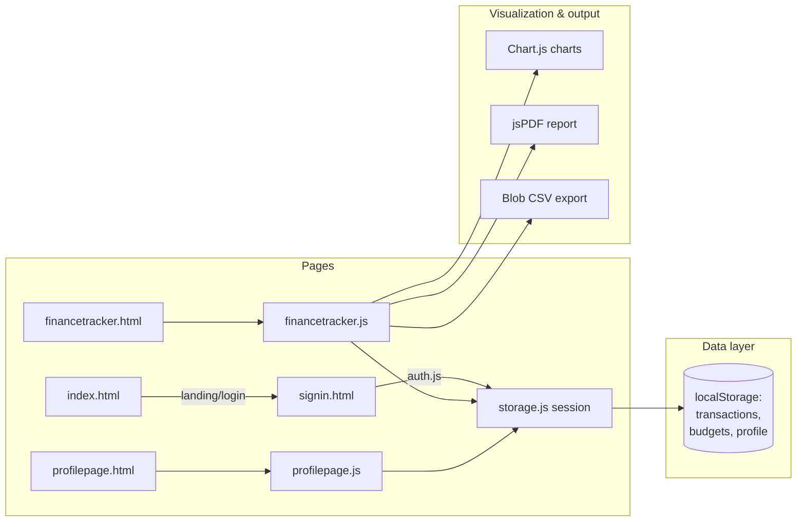

# MoneyMap — Finance Tracker

[](https://taksh1507.github.io/MoneyMap-Finance-Tracker/)
[](LICENSE)
[]()

**MoneyMap is a static client-side web app for tracking personal income, expenses, and budgets — with interactive charts and one-click PDF/CSV exports.**

---

## Problem Statement

Personal-budget apps typically require accounts, servers, or subscriptions. MoneyMap solves the lighter case: a single developer-friendly static site where a user can record transactions, monitor budgets against spending, and export reports — **all data stays on the user's device** (browser localStorage), with no backend and no data collection.

## Project Objectives

1. Make income/expense/budget tracking approachable and instant (no setup, no build step).
2. Visualize spending patterns with interactive charts (Chart.js).
3. Generate portable reports (PDF via jsPDF, CSV via Blob download).
4. Practice clean vanilla-JS module architecture without frameworks.

## Key Features

- **Dashboard** — total balance, income, expenses, and savings summary with recent-transaction feed
- **Transaction management** — add, edit, delete, categorize, and filter transaction records (provider categories: Food, Bills, EMI, Entertainment, Salary, Other)
- **Budget planning** — create/update/delete category budgets with utilization monitoring
- **Visualizations** — interactive expense-distribution and budget-usage charts (Chart.js)
- **Reports** — PDF report via jsPDF; CSV report via `Blob` + object URL download
- **Forecast** — 30-day expense forecast from historical spending
- **Profile & session** — mock client-side login (email stored in localStorage; passwords are never persisted)
- **Responsive glassmorphism UI** — mobile-friendly layouts (Poppins typography)

## Technology Stack

| Layer | Choice | Purpose |
| --- | --- | --- |
| Markup | HTML5 | 5 pages (landing, tracker, about, contact, profile) |
| Styling | CSS3 (glassmorphism, gradients) | Custom, per-page stylesheets |
| Logic | Vanilla JavaScript (ES modules) | Zero-dependency app logic |
| Charts | Chart.js 3.7.0 (vendored) | Expense/budget visualization |
| Reports | jsPDF 2.5.1 (vendored) | Client-side PDF generation |
| Storage | `localStorage` via `js/storage.js` | Transactions, budgets, profile session |
| Hosting | GitHub Pages | Static deployment, no build step |

## Architecture Overview

The app is a static multi-page site with a thin data-access module (`storage.js`) as the single source of truth for the client-side database. Each page is an ES module that imports only the storage API plus rendering libs.



- **Data flow:** UI event (`financetracker.js`) → `storage.js` mutation → `localStorage` persist → re-render tables/charts.
- **Escaping:** user-entered fields are HTML-escaped before DOM interpolation (`escapeHtml()` in `financetracker.js`) to prevent stored XSS.
- See [docs/02-architecture.md](docs/02-architecture.md) for module responsibilities and the persisted data model.

## Repository Structure

```text
MoneyMap-Finance-Tracker/
├── index.html               # Landing page (entry point)
├── html/                    # Application pages
│   ├── financetracker.html  # Dashboard: transactions, budgets, charts, reports
│   ├── signin.html          # Mock sign-in / sign-up
│   ├── profilepage.html     # User profile
│   ├── about.html
│   └── contact.html
├── css/                     # Per-page stylesheets
├── js/                      # App logic (ES modules)
│   ├── storage.js           # Data access layer (localStorage)
│   ├── financetracker.js    # Dashboard rendering + reports
│   ├── auth.js              # Mock login flow
│   └── profilepage.js       # Profile rendering
├── images/                  # Static assets
├── docs/                    # Technical documentation
│   ├── 01-project-overview.md
│   ├── 02-architecture.md
│   └── 03-testing-and-verification.md
├── LICENSE                  # MIT
└── README.md
```

## Prerequisites

- A modern browser (Chrome, Firefox, Edge, Safari).
- Any static file server — **required**, because `js/auth.js` and friends use native ES module imports, which browsers block when pages are opened via `file://`.

## Installation

```bash
git clone https://github.com/taksh1507/MoneyMap-Finance-Tracker.git
cd MoneyMap-Finance-Tracker
python -m http.server 8000        # or: npx serve .
```

## Usage

1. Open `http://localhost:8000` in your browser.
2. Sign up / sign in on `html/signin.html` (demo credentials — see limitations).
3. On **Finance Tracker**, add income/expense transactions, set budgets, and watch the charts update.
4. Request a **PDF report** (jsPDF) or **CSV export** from the toolbar.

## Database (client-side)

- `transactions` — `{ id: epoch-ms-string, date, desc, category, type: "Income"|"Expense", amount }`
- `budgets` — per-category limit records
- `profile` — session email + display name

All three persist under distinct `localStorage` keys managed exclusively by `js/storage.js`.

## Testing & Verification

Currently no automated suite (no test framework is a known gap). Verified during the latest repository audit:

| Check | Result |
| --- | --- |
| ES module syntax (`node --check`) | PASS — all JS parsed cleanly |
| Local static server smoke (10 routes/assets) | PASS — 10/10 HTTP 200 |
| README claims vs. implementation (PDF/CSV/forecast) | PASS — all implemented |
| Stored-XSS regression (escaping review of DOM writes) | PASS — `escapeHtml` applied to user-entered fields |
| GitHub Pages deployment (build + deploy jobs) | PASS — live URL 200 |

Details and how to re-run the checks: [docs/03-testing-and-verification.md](docs/03-testing-and-verification.md)

## Deployment

- **GitHub Pages (verified live):** https://taksh1507.github.io/MoneyMap-Finance-Tracker/ — pushes to `main` trigger the automatic pages build.
- Any static host works (Vercel/Netlify) since there is no build step; set the publish directory to the repository root.

## Implementation Status

- ✅ Dashboard, transactions, budgets, charts, PDF/CSV export, 30-day forecast — implemented and verified
- ✅ Responsive layout (mobile + desktop)
- ⚠️ Authentication — client-side mock only (intentional scope)

## Known Limitations

1. **No real backend** — data lives in the browser's localStorage; clearing browser data erases it (by design, documented, not a defect).
2. **Mock auth** — sign-up never persists passwords; do not use with real credentials.
3. **No automated tests** — verification is manual/scripted at runtime level; a Playwright suite is the natural next step.
4. **CDN-only third parties** — Chart.js/jsPDF/html2canvas load from CDN; offline usage needs vendoring.

## Future Improvements

- Real authentication with a lightweight backend (e.g., Supabase/Firebase) and cloud sync
- Export/import for full data portability (JSON backup/restore)
- Recurring transactions and monthly rollover
- Playwright end-to-end tests for the add/edit/delete flows

## Technical Documentation

- [Project overview](docs/01-project-overview.md)
- [Architecture](docs/02-architecture.md)
- [Testing & verification](docs/03-testing-and-verification.md)

## License

Released under the [MIT License](LICENSE).

## Regression tests and audit evidence

Use Node.js 22 or newer:

```bash
node --test tests/*.test.mjs
python -m http.server 8765 --bind 127.0.0.1
```

Open `http://127.0.0.1:8765/html/financetracker.html`. Editing preserves the saved
transaction until **Save Changes**. The tracker uses local copies of Chart.js,
jsPDF and html2canvas; their license headers and download sources are in
`js/vendor/`. Dependency security upgrades remain outstanding.

See `docs/audits/` for actual test results, remaining risks, and verified desktop
and mobile screenshots. Sign-in is a local demo, not an authentication boundary;
records share browser storage and are not encrypted.
