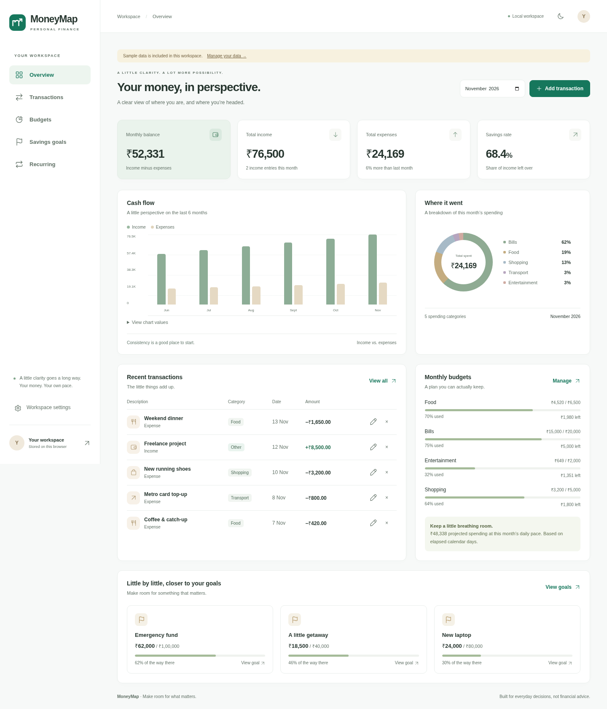
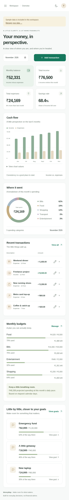
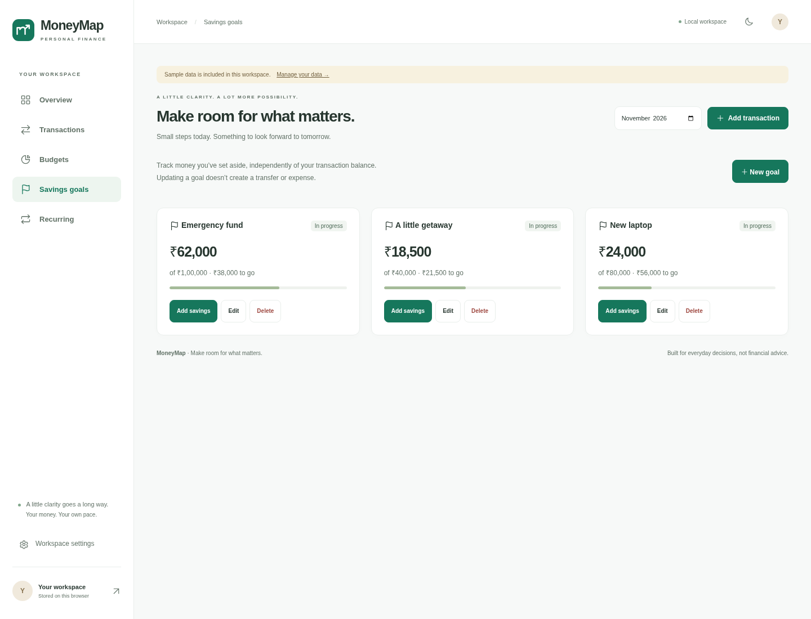
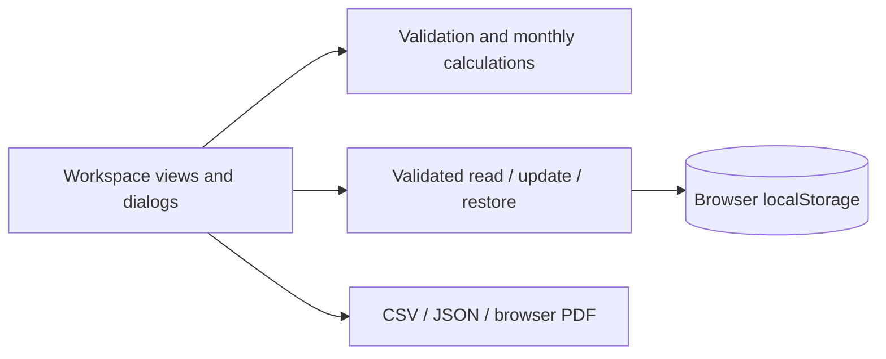

# MoneyMap

**Your money, in perspective.** A local-first finance workspace for tracking everyday spending, planning monthly budgets, and saving for what matters.

[](https://github.com/taksh1507/MoneyMap-Finance-Tracker/actions)
[](LICENSE)



## A workspace for the everyday

- **Monthly overview:** income, expenses, balance, savings rate, a six-month cash-flow chart, and spending by category.
- **Transaction ledger:** add, edit, delete, search, filter, sort, and paginate income and expenses.
- **Category budgets:** separate plans for each month, utilization bars, remaining amounts, and overspending states.
- **Savings goals:** set a target, track saved amounts, and add contributions without changing the transaction ledger.
- **Recurring reminders:** monthly income or expenses, short-month date adjustment, and one-time recording of due entries.
- **Portable records:** export filtered transactions to CSV, print a complete report or save it as PDF, and download/restore a complete JSON backup.
- **Make it yours:** light/dark themes, INR/USD/EUR/GBP display preferences, and responsive desktop, tablet, and mobile layouts.

No account is needed. Start with an empty workspace or explicitly load clearly marked sample data. Records live in your browser profile; keep backups to move them between devices.

<details>
<summary>See mobile and savings goals</summary>





Screenshots show the optional sample workspace, not actual financial records.
</details>

## Run locally

The application uses native HTML, CSS, and JavaScript modules. There is **no production dependency or build step**. Serve the repository over HTTP:

```bash
git clone https://github.com/taksh1507/MoneyMap-Finance-Tracker.git
cd MoneyMap-Finance-Tracker
python3 -m http.server 8765 --bind 127.0.0.1
```

Open `http://127.0.0.1:8765`. The previous `html/financetracker.html` URL also opens the workspace. Earlier sign-in/profile links lead to the corresponding workspace view.

For a static host such as GitHub Pages, publish the repository root. Relative asset paths support a project subdirectory. Runtime assets are served locally; the app does not request external fonts, chart services, or report libraries. A first visit still requires a connection to the host; this is not an installable offline PWA.

## How to use it

1. Add a transaction with a description, amount, date, type, and category.
2. Select a month to review that period. Use Transactions to search and export a subset.
3. Set monthly budgets or create a savings goal. Goal savings are tracked separately from your ledger balance.
4. Add recurring reminders. **Record entry** adds a due item once; it does not make a payment or run automatically.
5. In Workspace settings, download a backup before restoring data or clearing the workspace.

Currency selection changes display labels only; it does not convert existing amounts. Monthly totals include entries dated in the selected month. The spending projection uses recorded expenses through today divided by elapsed calendar days; it is an estimate, not a prediction.

## Architecture



| Module | Responsibility |
| --- | --- |
| `js/app.js` | View rendering, navigation, forms, filters, and export interactions |
| `js/model.js` | Data validation, monthly summaries, recurring dates, and CSV formatting |
| `js/storage.js` | Persistence, legacy-data normalization, and atomic workspace updates |
| `js/icons.js` | Local SVG interface icons |
| `css/workspace.css` | Responsive layout, themes, dialogs, and print presentation |

Amounts are summed as integer cents. Existing `moneyMapData` transactions preserve their IDs and amounts; legacy category budgets remain a default until a month-specific plan is saved. An unreadable workspace offers a download/recovery flow rather than replacing saved data. A backup is validated before it replaces current records.

## Development and verification

Use Node.js 22+ and Python 3:

```bash
npm ci --ignore-scripts
npm run check
npm test
npx playwright install chromium
npm run test:e2e
```

To use a system browser, set `PLAYWRIGHT_CHROMIUM_EXECUTABLE` to its path. The test runner starts a local static server automatically. Browser tests cover desktop, tablet, and mobile workflows, persistence, migration, restore, reports, keyboard interactions, and automated accessibility checks. See [verification](docs/03-testing-and-verification.md).

[Project overview](docs/01-project-overview.md) · [Architecture](docs/02-architecture.md) · [MIT license](LICENSE)

MoneyMap provides personal tracking tools, not financial advice or bank synchronization. Browser data is local to this site and profile; deleting browser data removes the workspace. Keep a backup somewhere you control.
