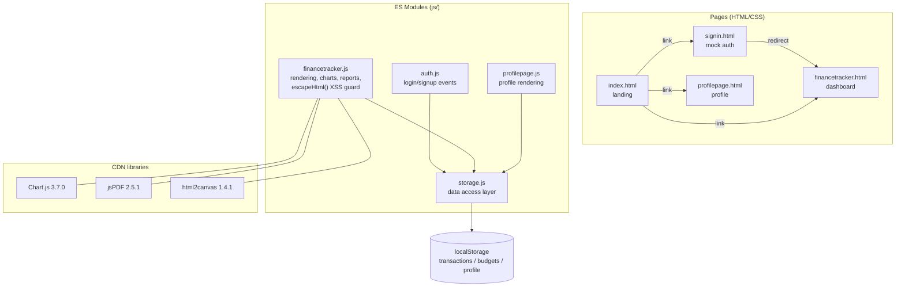
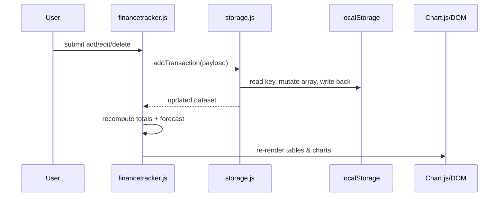

# 02 — Architecture

## High-Level Architecture

MoneyMap is a multi-page static application. Every page is a standalone HTML file; behavior is attached through ES modules (`type="module"`), and **all shared state flows through one data-access module**.

## Module Responsibilities

| Module | Responsibility |
| --- | --- |
| `storage.js` | **Single source of truth** for the client-side database: read/write transactions, budgets, income, and profile under distinct `localStorage` keys. Exposes `addTransaction`, `editTransaction`, `deleteTransaction`, `getTransactions`, `updateBudgets`, `getBudgets`, `updateIncome`, `getIncome`, `updateUserProfile`, `getUserProfile`, `login`, `logout`, `getLoggedInUser` (plus raw `getData`/`saveData`) |
| `financetracker.js` | Dashboard rendering: transaction table, summary cards, category totals, Chart.js visualizations, jsPDF/CSV report generation, 30-day forecast. Also hosts `escapeHtml()`, applied to every user-entered field before DOM interpolation |
| `auth.js` | Wires sign-in/sign-up forms; validates field presence only; stores the email in the session via `storage.js` |
| `profilepage.js` | Renders and updates the profile record |

## Data-Flow (write path)

All mutations follow the same read-modify-write-per-key pattern; the UI layer never touches `localStorage` directly.

## Persisted Data Model

| Key | Shape |
| --- | --- |
| Transaction | `{ id: "<Date.now() string>", date, desc, category, type: "Income"\|"Expense", amount: number }` |
| Budget | Per-category limit records created/edited via expense and budget forms |
| Profile/session | `{ email, firstName, lastName }` — the email acts as the mock session marker |

Provider categories (fixed taxonomy): `Food, Bills, EMI, Entertainment, Salary, Other` — unknown categories roll up to `Other` during aggregation.

## Security Design

- **Stored-XSS guard:** all dynamic DOM interpolation of user strings goes through `escapeHtml()` (`& < > " '`). The `onclick` handlers embed only the internally generated `id` (`Date.now().toString()`), never user text.
- **No credentials at rest:** password inputs are validated and discarded; localStorage never contains passwords or tokens.
- All third-party libraries load from CDN over HTTPS with specific pinned versions.

## Engineering Decisions

1. **No build step/bundler** — keeps the artifact auditable and host-portable; ES modules are sufficient at this scale.
2. **Single data-access module** — makes a future backend swap mechanical (replace `storage.js` internals with API calls without touching UI modules).
3. **CDN libraries with pinned versions** — smaller repo, consistent behavior; trade-off documented as an offline limitation.
4. **Client-side report generation** (jsPDF + Blob CSV) — zero server cost and data stays local.
